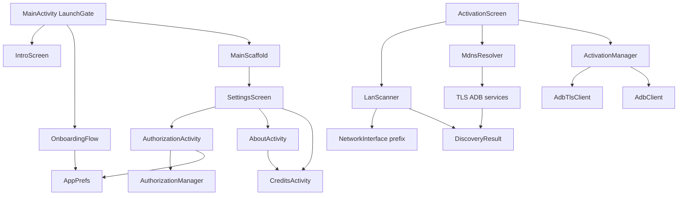

# v1.0.8 Enhancement — Technical Design

Feature Name: v1-0-8-enhancement
Updated: 2026-11-13

## Description

This release repairs the LAN discovery path, the language switching path and the launch gate, and introduces per-application authorization, an introduction screen, a restructured About page and a credits screen.

The application is a single-module Android project (`:app`) written in Kotlin with Jetpack Compose and the Miuix 0.9.0 design system. All new screens follow the existing `ScaffoldPage` / `SectionCard` / `SectionTitle` / `SettingRow` primitives in `ui/components/Components.kt`.

## Architecture



## Components and Interfaces

### 1. `adb/NetworkDiscovery.kt` (new)

Replaces the hardcoded `/24` assumption inside `LanScanner`.

```kotlin
data class LocalNetwork(
    val interfaceName: String,
    val ipv4: String,
    val prefixLength: Int,
    val subnetBase: String,
    val hostCount: Int,
)

object NetworkDiscovery {
    fun activeLocalNetworks(): List<LocalNetwork>
    fun hostsOf(network: LocalNetwork): List<String>
}
```

Behaviour:
- Reads `NetworkInterface.getNetworkInterfaces()`, keeps interfaces that are up, non-loopback and carry an IPv4 address.
- Classifies an interface as Wi-Fi or Ethernet by name pattern (`wlan`, `eth`, `en0` without `ap`/`rmnet`/`ccmni`/`ppp`) or by the absence of a cellular-style name. Cellular and VPN interfaces are excluded from the sweep.
- Computes the subnet base by applying the interface prefix length to the local IPv4 address.
- `hostsOf` enumerates the usable host range for the prefix length, capped at 1024 hosts to bound the sweep.

### 2. `adb/LanScanner.kt` (modified)

- `localSubnets()` is replaced by `NetworkDiscovery.activeLocalNetworks()`.
- `SCAN_PORTS` keeps 5555 as the primary plain-ADB port and adds 5554 and 5556–5559.
- `probe()` keeps the plain-ADB CNXN handshake and additionally records whether the daemon requested authentication.
- A new `suspend fun discover(onLog, onProgress): List<FoundDevice>` entry point merges plain-ADB sweep results with mDNS TLS service results, deduplicates by host and port, and emits a step log.

### 3. `adb/MdnsResolver.kt` (modified)

`discover(TYPE_CONNECT, timeoutMs)` already returns the TLS connect services. The new merge step consumes these results directly; the resolver itself stays unchanged.

### 4. `ui/activation/ActivationScreen.kt` (modified)

- The TCP panel gains an AxManager-style step log area with a copy action.
- The device list renders a badge per device: `TLS`, `待授权` or `已授权`.
- The scan button reports the number of subnets and the probe total before starting.
- Manual host and port fields stay available for devices outside the swept subnets.

### 5. `core/AuthorizationManager.kt` (new)

```kotlin
enum class AuthLevel { READ, FULL }

data class AuthRecord(val packageName: String, val level: AuthLevel, val grantedAt: Long)

class AuthorizationManager(context: Context) {
    fun records(): List<AuthRecord>
    fun isAuthorized(packageName: String): Boolean
    fun levelOf(packageName: String): AuthLevel?
    fun grant(packageName: String, level: AuthLevel)
    fun revoke(packageName: String)
    fun revokeAll()
}
```

Storage lives in `AppPrefs` under the key family `auth_grant:<package>` holding `level|timestamp`.

### 6. `ui/authorization/AuthorizationActivity.kt` (new)

- Lists installed user applications with icon, label, package name and authorization state.
- Provides search by label and package name.
- Each row offers grant, revoke and level selection.
- A summary card shows the total granted count.

### 7. `core/AccessRequestReceiver.kt` (new)

An exported `BroadcastReceiver` registered in the manifest under the action `com.wangucanghai.isposed.action.REQUEST_ACCESS`. It:
- Reads the requesting package name from the intent extra `requester`.
- Raises the confirmation surface through `MainActivity` via a `PendingIntent`-free single-top intent extra.
- Persists the grant or the denial according to the user decision.

### 8. `core/i18n` (new)

- `res/values/strings.xml` holds the Simplified Chinese source strings and stays the default locale.
- `res/values-en/strings.xml` holds the English translations.
- `res/values-zh/strings.xml` is created as an explicit alias of the default so "follow system" resolves to Chinese on Chinese devices.
- `core/LocaleHelper.applyToSystem` additionally calls `AppCompatDelegate.setApplicationLocales` semantics through the platform `LocaleManager` on Android 13+, and `BaseActivity.attachBaseContext` applies the stored locale on older releases.
- All Compose screens read strings through `stringResource(R.string.<key>)`.

### 9. `ui/notice/OnboardingFlow.kt` (modified)

- The consent controls remain visible as records of the user's reading, but the primary action advances regardless of their state.
- The flow persists `agreementVersion` and `aiNoticeAccepted` on completion.

### 10. `ui/MainActivity.kt` (modified)

- `LaunchGate` states become `INTRO`, `CHANGELOG`, `ONBOARDING`, `READY`.
- The per-launch blocking `AGREEMENT` dialog is removed. The agreement text is reachable from Settings and About.
- The changelog dialog dismisses to `Gate.READY` after acknowledging, and the announcement clears its pending version.

### 11. `ui/intro/IntroScreen.kt` (new)

Full-screen hero layout: animated logo, application name, tagline, three feature cards and a primary action. Back handling keeps the screen in place.

### 12. `ui/AboutActivity.kt` (modified)

Restructured into: identity card (name, version, version code, package name), signing certificate digest, feature list, upstream project table, license expansion and navigation rows to the credits screen and the agreement text.

### 13. `ui/credits/CreditsActivity.kt` (new)

Grouped credits list: upstream projects (LSPosed, AxManager, Miuix, Jetpack Compose), design and testing contributors, and the author block with the repository address.

## Data Models

| Model | Storage | Fields |
|---|---|---|
| Authorization record | SharedPreferences `auth_grant:<pkg>` | level, grantedAt |
| Intro seen | SharedPreferences `intro_seen` | boolean |
| Language | SharedPreferences `app_language` | system / zh / en |
| Agreement version | SharedPreferences `agreement_version` | int |

## Correctness Properties

1. A discovery pass never scans a cellular interface, so the sweep completes within the wireless network the device is attached to.
2. The number of hosts scanned per interface equals the usable host count for its prefix length, capped at 1024.
3. Every device entry in the list corresponds to an endpoint that answered an ADB handshake or an mDNS connect advertisement.
4. The application reaches `Gate.READY` from any launch path without requiring a consent control to be checked.
5. The rendered interface language equals the stored language at every composable entry point.
6. An authorization record exists for a package name if and only if the user granted it, and revoking removes it.

## Error Handling

| Scenario | Handling |
|---|---|
| No Wi-Fi or Ethernet interface | Report the missing network in the discovery log and skip the sweep |
| Interface enumeration throws | Log the failure and return an empty network list |
| Probe raises an error | Treat the candidate as absent and continue the sweep |
| mDNS resolution times out | Continue with the plain-ADB sweep results only |
| Authorization request from an unknown package | Decline the request and reply with a denial result |
| Resource string missing for a locale | Fall back to the default locale value from `res/values` |

## Test Strategy

- `:app:compileDebugKotlin` must pass with no new warnings beyond the known `BluetoothSearching` deprecation.
- `:app:assembleRelease` must produce an APK whose signing digest matches the previous release digest `5ee60bdca8cf1c29f15324f2145ee93f4e0d8b2274002e6c0a2472182621db7c`.
- The release APK must report `versionCode 9` and `versionName 1.0.8`.
- Manual device verification covers: LAN discovery on a Wi-Fi network, language switching between Chinese and English without relaunch, onboarding traversal without checking the consent controls, the introduction screen on first launch, authorization grant and revoke, and the credits screen navigation.

## References

[^1]: (AxManager user manual) - Activation methods and per-application authorization model (http://axmanager.app/zh/guide/user-manual.html)
[^2]: (`app/src/main/java/com/wangucanghai/isposed/adb/LanScanner.kt#L44`) - Hardcoded port list and `/24` subnet assumption
[^3]: (`app/src/main/java/com/wangucanghai/isposed/ui/components/LanguagePicker.kt#L53`) - Language change path that persists without changing rendered text
[^4]: (`app/src/main/java/com/wangucanghai/isposed/ui/MainActivity.kt#L157`) - Per-launch blocking agreement dialog
[^5]: (`app/src/main/java/com/wangucanghai/isposed/ui/notice/OnboardingFlow.kt#L157`) - Forced consent state on the primary action
